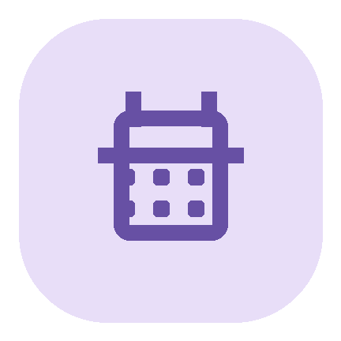

<p align="center">
  
</p>

<h1 align="center">CampusTimetable</h1>

<p align="center">
  
  
  
  
  
  
  
</p>

<p align="center">A free, ad-free, offline-first timetable app for Android</p>
<p align="center"><a href="README.md">简体中文</a> · <a href="README.en.md">English</a></p>

## Why this app

Finding a convenient timetable app can be harder than it should be. Checking a schedule on a university portal often takes too many steps; ads interrupt some free apps; and importing an existing timetable can be awkward in some free and open-source tools. CampusTimetable aims to make this easier: it focuses on viewing and managing classes, makes importing straightforward, stores data on the device, and requires no account or ads.

## Features

- **Weekly timetable**: Browse classes by weekday and period, move between weeks, view course details, see conflict warnings, and display classes that span multiple periods.
- **Quick add and editing**: Add a class from the timetable and edit its name, instructor, location, color, weeks, and multiple meeting times.
- **Flexible semester and periods**: Set the semester start date and length, configure the number and times of periods, and mark lunch or other rows as placeholders.
- **JSON import**: Import from a file or pasted text. Validate and preview the schedule before appending it or replacing existing courses. Week ranges and alternating weeks are supported.
- **Course notifications**: Set a default reminder and customize it for individual courses. Reminders are sent as Android notifications.
- **Themes and appearance**: Choose light, dark, pure black, or Monet dynamic colors; customize course colors and presets; switch between Chinese and English.
- **Backup and sharing**: Export and restore a full backup of courses and app settings, or share an image of the current week.
- **Page animations**: Turn page and week-transition animations on or off in theme settings.

The app supports Android 8.0 (API 26) and later. Timetable data and settings are stored locally. No account or cloud sync is required.

## Import a timetable

Import a JSON file or paste its contents. Review the validation and preview, then choose whether to append the courses or replace the existing timetable. See the format guide and sample:

- [JSON timetable import guide](JSON课表导入说明.md)
- [Sample timetable](课表导入示例.json)

## Tech stack

- Kotlin, Android SDK, View Binding
- Material Components, AndroidX AppCompat, Core KTX
- Room for the local course database; DataStore Preferences for app settings
- Gradle, Android Gradle Plugin, KSP
- Java 17 toolchain; minimum API 26

## Build locally

You need JDK 17, Android SDK Platform 37, and Android SDK Build Tools. Build a debug APK with:

```bash
./gradlew assembleDebug
```

The APK is written to `app/build/outputs/apk/debug/app-debug.apk`.

To build a release APK, configure your own signing file and credentials through environment variables:

```bash
export CAMPUS_KEYSTORE=/path/to/your-keystore.jks
export CAMPUS_STORE_PASSWORD=...
export CAMPUS_KEY_ALIAS=...
export CAMPUS_KEY_PASSWORD=...
./gradlew assembleRelease
```

Do not commit signing keys or passwords. This repository does not include signing credentials.

## License

This project is licensed under the [MIT License](LICENSE). Third-party dependencies remain under their respective licenses.
