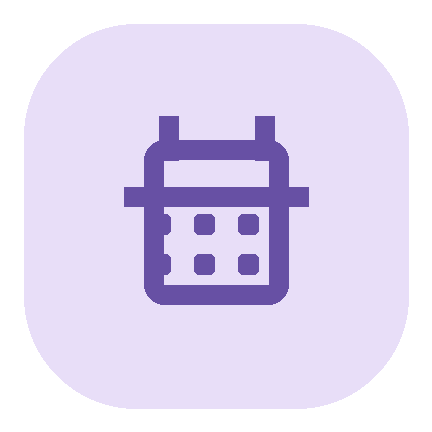

<p align="center">
  
</p>

<h1 align="center">CampusTimetable</h1>

<p align="center">
  
  
  
  
  
  
  
</p>

<p align="center">一款免费、无广告、离线优先的 Android 课表应用</p>
<p align="center"><a href="README.md">简体中文</a> · <a href="README.en.md">English</a></p>

## 为什么做这个应用

如今要找一款顺手的课表工具并不容易：学校教务系统查课表步骤多，临时查看不够方便；一些免费应用会显示广告，打断使用；部分免费开源课表虽然可以自行管理，却不容易把已有课表导进来。CampusTimetable 想把这些事情变简单：专注查看和管理课程，支持便捷导入，数据保存在本机，不需要账号，也不展示广告。

## 功能

- **周课表**：按星期和课时查看课程，支持周次切换、课程详情、冲突提示，以及课程跨多个课时显示。
- **快速添加与编辑**：从课表页面快捷添加课程；可编辑课程名称、教师、地点、颜色、周次和多段上课安排。
- **灵活的课时与学期**：自定义学期起始日期、周数、课时数量和每节课的时间，也可设置午休等占位课时。
- **JSON 导入**：从文件或粘贴文本导入，先检查格式并预览，再选择追加或替换；支持周次范围和单双周安排。
- **课程提醒**：设置默认提醒时间，也可为单门课单独调整；提醒通过 Android 通知发送。
- **主题与外观**：浅色、深色、纯黑和 Monet 动态颜色主题；可调整课程颜色、管理颜色预设，并选择中英文界面。
- **备份与分享**：导出和恢复包含课程及应用设置的完整备份，也可分享当前周课表图片。
- **桌面小组件**：提供“今日课程”和“下一节课”，显示课程时间与地点，支持缩放、手动刷新、中英界面及四种主题。
- **页面动画**：可在主题设置中开关页面和切周动画。

应用面向 Android 8.0（API 26）及以上版本。课表与设置保存在设备本地；应用不要求登录或云同步。
新安装会预置第 9 周周四、周五的少量示例课程；旧安装中的现有课程不会被这项调整清除。

## 桌面小组件

在应用的“设置 → 桌面小组件”中选择组件并确认添加，也可以长按桌面空白处，从小组件列表中找到 CampusTimetable。

“今日课程”优先展示尚未结束的课程；全部结束后显示当天最后几节。“下一节课”会显示正在上的课，或本学期接下来的一次上课安排。点击组件打开课表，右上角按钮可手动刷新。修改课程、学期、课时或主题后会同步刷新；系统休眠时，定时刷新可能延后至设备唤醒。

## 导入课表

导入支持从 JSON 文件选择或直接粘贴内容。预览确认后，可以把课程追加到现有课表，或替换现有课程。格式说明和示例：

- [JSON 课表导入说明](JSON课表导入说明.md)
- [课表导入示例](课表导入示例.json)

## 技术栈

- Kotlin、Android SDK、View Binding
- Material Components、AndroidX AppCompat、Core KTX
- Room（本地课程数据库）、DataStore Preferences（应用设置）
- Gradle、Android Gradle Plugin、KSP
- Java 17 工具链；最低支持 API 26

## 本地构建

需要 JDK 17、Android SDK Platform 37，以及可用的 Android SDK Build Tools。构建 Debug APK：

```bash
./gradlew assembleDebug
```

APK 输出位置：`app/build/outputs/apk/debug/app-debug.apk`。

如需构建 Release APK，请通过环境变量配置自己的签名文件和凭据：

```bash
export CAMPUS_KEYSTORE=/path/to/your-keystore.jks
export CAMPUS_STORE_PASSWORD=...
export CAMPUS_KEY_ALIAS=...
export CAMPUS_KEY_PASSWORD=...
./gradlew assembleRelease
```

请勿提交签名密钥或密码。仓库不包含应用签名凭据。

## 许可证

本项目以 [MIT License](LICENSE) 授权。第三方依赖遵循各自的许可证。
